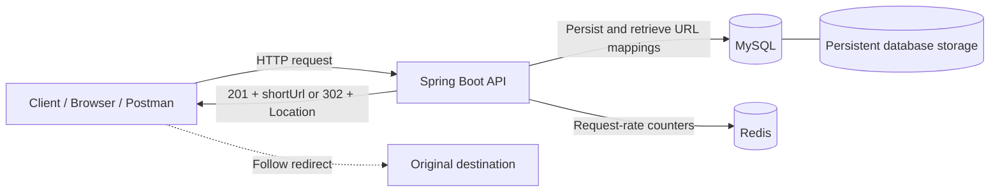

# Distributed URL Shortener

**A deployed Java 17 backend for creating short links and redirecting users to their original destinations.**

Built with Spring Boot, MySQL, Redis, and Docker, this project brings together REST API design, persistent storage, Redis-backed rate limiting, container networking, and cloud deployment.

**[Live API](https://url-shortener-production-5d1a.up.railway.app)** · **[Source code](https://github.com/karan-sahani-dev/url-shortener)** · [Try the API](#try-the-api) · [Run locally](#run-locally)

> **Architecture scope:** One Spring Boot application connects to separate MySQL and Redis services. “Distributed” describes these networked components; horizontal scaling, high availability, and performance at scale have not been demonstrated.

## At a glance

| Capability | Implementation |
|---|---|
| Create a short link | `POST /api/urls/shorten` → `201 Created` |
| Follow a short link | `GET /{shortCode}` → `302 Found` with a `Location` header |
| Store URL mappings | MySQL persistence |
| Control request volume | Redis-backed IP rate limiting |
| Reject invalid input | Request validation and `400 Bad Request` |
| Handle missing links | `404 Not Found` |
| Run the complete stack | Docker Compose with MySQL health checks and a persistent volume |
| Deploy the application | Multi-stage Docker build on Railway |
| Configure environments | Database, Redis, server port, and public base URL through environment variables |

## Live demo

**API base URL:** https://url-shortener-production-5d1a.up.railway.app

This is a backend API. Use the shortening endpoint below to create a link, then open the returned `shortUrl` in a browser. The base URL is not a documented frontend page.

The deployed creation and redirect flow was confirmed during deployment: creation returned `201 Created` with the Railway domain, and following the generated link returned `302 Found`.

## Architecture



### Create a link

1. The client submits an `originalUrl`.
2. Request validation and rate-limit checks guard the request.
3. The application generates a short code and stores the URL mapping in MySQL.
4. It constructs the public short URL using `APP_BASE_URL`.
5. The API returns `201 Created` with `originalUrl`, `shortCode`, and `shortUrl`.

### Follow a link

1. The client requests `/{shortCode}`.
2. The application resolves the stored destination.
3. A known code returns `302 Found` with the destination in `Location`.
4. An unknown code returns `404 Not Found`.

MySQL holds durable URL mappings. Redis backs request-rate counters. The architecture diagram focuses on these core responsibilities and does not imply replication or multiple application instances.

## Technology stack

| Area | Technology |
|---|---|
| Language | Java 17 |
| Application framework | Spring Boot |
| HTTP API | Spring Web |
| Persistence | Spring Data JPA / Hibernate, MySQL |
| Request-rate storage | Redis |
| Input validation | Jakarta Bean Validation |
| Build | Maven |
| Containers | Docker, multi-stage Dockerfile |
| Local services | Docker Compose |
| Hosting | Railway |
| Manual API testing | Postman, curl |

## Try the API

### 1. Create a short URL

```http
POST /api/urls/shorten
Content-Type: application/json

{
  "originalUrl": "https://www.google.com"
}
```

Run this command in Bash or a compatible shell:

```bash
curl -i \
  -X POST "https://url-shortener-production-5d1a.up.railway.app/api/urls/shorten" \
  -H "Content-Type: application/json" \
  -d '{"originalUrl":"https://www.google.com"}'
```

Example response:

```http
HTTP/1.1 201 Created
Content-Type: application/json
```

```json
{
  "originalUrl": "https://www.google.com",
  "shortCode": "JMHt6N",
  "shortUrl": "https://url-shortener-production-5d1a.up.railway.app/JMHt6N"
}
```

The short code is generated for each request. The value above is illustrative; use the `shortUrl` returned by your own request.

On Windows, the equivalent PowerShell request is:

```powershell
$baseUrl = "https://url-shortener-production-5d1a.up.railway.app"
$body = @{ originalUrl = "https://www.google.com" } | ConvertTo-Json
$result = Invoke-RestMethod -Method Post `
    -Uri "$baseUrl/api/urls/shorten" `
    -ContentType "application/json" `
    -Body $body
$result
```

### 2. Inspect the redirect

Replace `YOUR_SHORT_CODE` with the code returned above:

```bash
curl -i "https://url-shortener-production-5d1a.up.railway.app/YOUR_SHORT_CODE"
```

Expected response:

```http
HTTP/1.1 302 Found
Location: https://www.google.com
```

In PowerShell, use the returned URL directly:

```powershell
curl.exe -i $result.shortUrl
```

These commands issue a GET without automatically following the redirect. In Postman, disable automatic redirect following to inspect the `302` response. Opening the link in a browser follows it to the destination.

### HTTP behavior

| Scenario | Expected status |
|---|---|
| Valid shortening request | `201 Created` |
| Existing short code | `302 Found` |
| Invalid or blank URL | `400 Bad Request` |
| Malformed JSON | `400 Bad Request` |
| Unknown short code | `404 Not Found` |
| Request-rate limit exceeded | `429 Too Many Requests` |

## Run locally

### Option A: Complete stack with Docker Compose

**Prerequisites:** Git and Docker with Compose support, such as Docker Desktop.

```bash
git clone https://github.com/karan-sahani-dev/url-shortener.git
cd url-shortener
```

Create a `.env` file beside `docker-compose.yml`:

```dotenv
MYSQL_ROOT_PASSWORD=replace-with-a-local-root-password
DB_NAME=urlshortener
DB_USERNAME=urluser
DB_PASSWORD=replace-with-a-local-app-password
```

Replace the example passwords before starting. Keep `.env` out of version control.

```bash
docker compose up --build -d
docker compose ps
docker compose logs -f
```

The local API is available at `http://localhost:8080`. Use that base URL with the same requests shown above.

The Compose setup runs the application, MySQL, and Redis on a shared network:

- The application reaches MySQL at `mysql:3306` and Redis at `redis:6379`.
- MySQL health checks gate application startup until the database is ready.
- The `mysql_data` volume stores MySQL data at `/var/lib/mysql`.
- The multi-stage Dockerfile builds the application with Maven and copies the executable JAR into a Java 17 runtime image.

Stop the stack with:

```bash
docker compose down
```

The named database volume survives ordinary container removal. Adding `-v` to the command deletes the volume and its data.

### Option B: Run Spring Boot from the host

**Additional prerequisites:** JDK 17 and Maven, or the repository's Maven wrapper.

Start only the infrastructure services:

```bash
docker compose up -d mysql redis
docker compose ps
```

Set the application's environment variables in your terminal or IDE. When running Java on the host, use `localhost` and the **published host ports** shown by Compose, rather than the container service names.

For example, if MySQL is mapped as `3307:3306` and Redis as `6379:6379`, use:

```dotenv
DB_HOST=localhost
DB_PORT=3307
DB_NAME=urlshortener
DB_USERNAME=urluser
DB_PASSWORD=the-same-local-app-password
REDIS_HOST=localhost
REDIS_PORT=6379
REDIS_USERNAME=default
REDIS_PASSWORD=
APP_BASE_URL=http://localhost:8080
PORT=8080
```

Then run:

```bash
mvn spring-boot:run
```

Alternatively, use `./mvnw spring-boot:run` on macOS/Linux or `.\mvnw.cmd spring-boot:run` on Windows.

Docker Compose reads `.env` for its configuration. A direct Maven or IDE launch does not automatically import that file; supply the variables to the Java process.

## Environment variables

| Variable | Purpose | Local value / guidance |
|---|---|---|
| `DB_HOST` | MySQL hostname | `mysql` in Compose; `localhost` from the host |
| `DB_PORT` | MySQL connection port | `3306` between containers; published port from the host |
| `DB_NAME` | Application database | `urlshortener` |
| `DB_USERNAME` | Database user | Match the provisioned MySQL user |
| `DB_PASSWORD` | Database password | Supply through the environment |
| `REDIS_HOST` | Redis hostname | `redis` in Compose; `localhost` from the host |
| `REDIS_PORT` | Redis connection port | `6379`, unless mapped differently |
| `REDIS_USERNAME` | Redis ACL username | `default` locally; use service credentials on Railway |
| `REDIS_PASSWORD` | Redis password | Empty only for a local Redis instance configured without authentication |
| `APP_BASE_URL` | Public origin used to construct short URLs | Defaults to `http://localhost:8080`; no trailing `/` |
| `PORT` | Application listening port | Defaults to `8080` |
| `MYSQL_ROOT_PASSWORD` | Initializes the local MySQL container | Compose infrastructure setting, not an application credential |

The application uses environment-backed properties, including:

```properties
server.port=${PORT:8080}
app.base-url=${APP_BASE_URL:http://localhost:8080}
```

Changing the listening port does not automatically change the public base URL. Set `APP_BASE_URL` to the address clients should use.

## Railway deployment

The deployed topology consists of the Spring Boot application, a MySQL service, and a Redis service in Railway.

To reproduce the deployment:

1. Connect the GitHub repository to an application service.
2. Add MySQL and Redis services to the project.
3. Build the application using the root-level multi-stage `Dockerfile`.
4. Configure the application's database and Redis variables using service references.
5. Expose the application through a public domain and set `APP_BASE_URL` to that HTTPS origin.
6. Deploy, inspect startup logs, and run the creation and redirect smoke tests.

For services named `MySQL` and `Redis`, the project's reference mapping is:

```dotenv
DB_HOST=${{MySQL.MYSQLHOST}}
DB_PORT=${{MySQL.MYSQLPORT}}
DB_NAME=${{MySQL.MYSQLDATABASE}}
DB_USERNAME=${{MySQL.MYSQLUSER}}
DB_PASSWORD=${{MySQL.MYSQLPASSWORD}}

REDIS_HOST=${{Redis.REDISHOST}}
REDIS_PORT=${{Redis.REDISPORT}}
REDIS_USERNAME=${{Redis.REDISUSER}}
REDIS_PASSWORD=${{Redis.REDISPASSWORD}}

APP_BASE_URL=https://url-shortener-production-5d1a.up.railway.app
```

Use the actual service names and credentials in your Railway project. For a separate deployment, replace `APP_BASE_URL` with its own domain. The application supports the runtime `PORT` value supplied by the environment.

Compose's local `mysql_data` volume does not configure Railway storage. Configure persistent storage for the Railway MySQL service separately.

### Deployment lessons

- **Networking:** `localhost` inside the application container refers to that container. Database and Redis connections need their service addresses.
- **Authentication:** Redis host and port alone are insufficient when the deployed Redis service requires credentials.
- **Public URLs:** An environment-based public origin prevents production responses from returning `localhost` links.
- **Build reproducibility:** Building the JAR inside Docker removes the dependency on a developer's local `target/` directory.
- **Startup readiness:** A running database container may still be initializing; MySQL health checks address that startup gap locally.

## Testing and verification

The following is a repeatable manual test plan. It is not a claim of automated coverage or load-test results.

| Test | Procedure | Expected result |
|---|---|---|
| Create | Submit a valid `originalUrl` | `201`; response includes a usable `shortUrl` |
| Redirect | GET the returned URL without following redirects | `302`; `Location` matches the original URL |
| Validation | Submit a blank or invalid URL | `400` |
| Missing mapping | Request a code absent from the database | `404` |
| Duplicate input | Shorten the same URL twice | Different short codes |
| Rate limiting | Exceed the configured request limit in a local test | `429` |
| Persistence | Create a link, run `docker compose down`, restart, then resolve it | The mapping still exists |
| Deployment configuration | Create a link on Railway | `shortUrl` uses the Railway HTTPS domain |

Run rate-limit checks locally and allow the configured window to expire before other tests. Do not use the public demo for load testing.

To execute the repository's Maven tests with the required environment configured:

```bash
mvn test
```

The documented Docker build uses `-DskipTests`; a successful image build is not evidence that tests passed.

## Engineering decisions

| Decision | Rationale and tradeoff |
|---|---|
| MySQL for mappings | Links need durable storage beyond application restarts. Database availability remains part of the service's operational requirements. |
| Redis for rate counters | Request-rate state lives outside the Java process. This is a useful foundation for shared limiting, but does not prove correctness across multiple replicas. |
| HTTP `302` redirects | The API returns a standard redirect that browsers understand; clients control whether to follow it. |
| Environment-based configuration | The same application can use different credentials, service addresses, ports, and public domains across local and cloud environments. |
| Docker Compose | Makes the application and its dependencies reproducible locally, including networking, health checks, and persistent storage. |
| Multi-stage Docker build | Separates compilation from runtime and keeps Maven build tooling out of the final image. |

## Current behavior and limitations

- **Duplicate long URLs create new short codes.** Shortening the same destination twice creates two links; the endpoint does not currently deduplicate requests.
- **This is a single application service with external dependencies.** Multi-replica operation, failover, and high availability are not established.
- **No throughput or latency guarantees are claimed.** Performance benchmarks are a future validation task.
- **Persistence is not backup.** A local named volume preserves data across container recreation but does not provide a backup or recovery strategy.
- **The documented public API covers creation and redirection.** Analytics, custom aliases, authentication, and link expiration are not advertised as implemented features.

## Future improvements

- Add automated integration tests for MySQL persistence, Redis rate limiting, validation, and redirects.
- Verify database-enforced short-code uniqueness and collision retries under concurrent creation.
- Define and test rate-limit behavior under concurrent requests, Redis failures, and trusted proxy forwarding.
- Add versioned database migrations and a tested backup/restore workflow.
- Benchmark URL resolution and validate cache hit, miss, expiration, and failure behavior.
- Introduce optional URL deduplication, custom aliases, and link expiration.
- Add authentication or API keys with per-user quotas.
- Add click analytics, operational metrics, structured logs, and tracing.
- Validate multiple application replicas before making horizontal scalability claims.
- Add CI checks that run tests before deployment.

## Author

**Karan Sahani**

Backend development with Java, Spring Boot, databases, and containerized applications.

[GitHub](https://github.com/karan-sahani-dev) · [Project repository](https://github.com/karan-sahani-dev/url-shortener)
